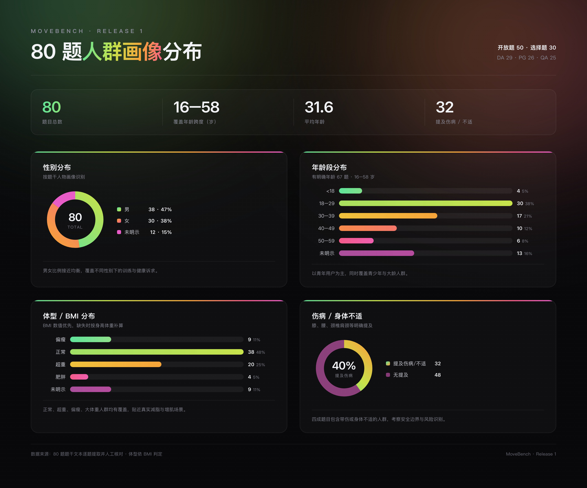

# MoveBench

A Chinese benchmark for evaluating large language models as sports and health coaches · **MoveBench Team × Capital University of Physical Education and Sports**

[Paper](https://arxiv.org/abs/2610.26185) · [Online questions & leaderboard](https://keep-tech.github.io/MoveBench/) · [Submission guide](docs/SUBMISSION.md) · [Data schema](docs/SCHEMA.md)

This release provides **80 Chinese-language questions** across three scenarios: personalized training plan generation (PG), sports data analysis (DA) and professional knowledge QA (QA). It includes **50 open-ended questions (OQ)** and **30 multiple-choice questions (MCQ)**.

# Participation
If you'd like to evaluate your model's capabilities in sports and health-related scenarios using the full MoveBench benchmark of 809 questions, we invite you to participate in our evaluation program.
Our team of sports science professionals will provide a comprehensive evaluation report, free of charge, offering insights into your model's performance.
Interested? Contact us at **benchmarkcontact@keep.com**.

## Leaderboard (Release 1 · 80 questions)

| Rank | Model | Overall | OQ (50) | MCQ (30) | PG | DA | QA |
|---:|---|---:|---:|---:|---:|---:|---:|
| 1 | Claude Opus 5.5 | **0.897** | 0.892 | 1.000 (30/30) | 0.860 | 0.927 | 0.947 |
| 2 | Qwen3.8-Max | **0.886** | 0.880 | 1.000 (30/30) | 0.839 | 0.932 | 0.938 |
| 3 | GLM-5.3 | **0.878** | 0.872 | 1.000 (30/30) | 0.825 | 0.925 | 0.947 |
| 4 | MiniMax-M3 | **0.864** | 0.859 | 0.967 (29/30) | 0.803 | 0.911 | 0.949 |
| 5 | Kimi-K3 | **0.860** | 0.853 | 1.000 (30/30) | 0.804 | 0.904 | 0.936 |
| 6 | HY3 | **0.858** | 0.851 | 1.000 (30/30) | 0.811 | 0.896 | 0.919 |
| 7 | Doubao-Seed-2.1-Pro | **0.857** | 0.850 | 1.000 (30/30) | 0.803 | 0.904 | 0.925 |
| 8 | GPT-6 | **0.848** | 0.842 | 0.967 (29/30) | 0.802 | 0.897 | 0.897 |
| 9 | Gemini-4-Argon | **0.838** | 0.830 | 1.000 (30/30) | 0.776 | 0.894 | 0.913 |
| 10 | MiMo-V2.6-Pro | **0.837** | 0.830 | 1.000 (30/30) | 0.778 | 0.878 | 0.924 |

## What's in this release

| Scope | Count |
|---|---:|
| OQ · open-ended (with rubric criteria and reference answers) | 50 |
| MCQ · multiple-choice (11 single-select / 19 multi-select, with gold answers) | 30 |
| Total | **80** |

By domain: DA 29 / PG 26 / QA 25. The open-ended questions carry 464 rubric criteria in total.

- `data/questions.json`: questions only, with IDs, domains and formats (OQ have empty choices; MCQ include choices). No reference answers or rubrics. Use this to generate answers with the model under test.
- `data/benchmark.json` / `data/test.jsonl`: full records. OQ include rubrics and reference answers; MCQ include choices and gold answers. For scoring, research and re-computing scores yourself.
- `data/submission_template.json`: answer submission template covering all 80 questions.
- `data/manifest.json`: version, counts, checksums and dataset identity.
- `tools/`: tools for generating model answers and validating answer files.

## User profiles behind the questions

All 80 questions are built from real user profiles covering a range of genders, ages, body types and health conditions which is the same as the full 809 questions collection.



| Dimension | Distribution |
|---|---|
| Gender | Male 38 · Female 30 · Not stated 12 |
| Age | 16–58 (mean 31.6); most common 18–29 (30 questions), then 30–39 (17), 40–49 (10), 50–59 (6), under 18 (4) |
| Body type / BMI | Normal 38 · Overweight 20 · Underweight 9 · Obese / heavy 4 · Not stated 9 |
| Injury / discomfort | Mentioned in 32 questions (knee, lower back, neck and shoulders, etc.) · Not mentioned in 48 |

The profiles also cover teenagers (under 18) and older users (50+), heavier users and people trying to lose fat, people building muscle, office workers who sit for long periods, and users who are injured or recovering. This variety keeps the evaluation close to real sports and health coaching scenarios.

## Download and generate answers

```bash
git clone https://github.com/Keep-Tech/MoveBench.git
cd MoveBench
python3 tools/validate.py
export STUDENT_API_KEY='set this locally; never commit it to GitHub'
python3 tools/run_student.py --model organization/exact-model-version \
  --base-url https://api.example.com/v1 --output predictions.json
python3 tools/validate.py --submission predictions.json
```

Requires Python 3.10+. The public tools use only the standard library. `run_student.py` sends the full question text for OQ, and for MCQ it appends the choices and asks for option letters. You can also generate answers in the same format with local weights or another API; the question inputs are identical to the original Release 1.

## Submit and get on the leaderboard

1. Answer all 80 questions. Provide the exact model version and generation settings, and disclose whether the model has been exposed to this question set, earlier reference answers or scoring materials.
2. Submit your answers in a pull request at `submissions/<model>-<date>.json`. Do not submit API keys.
3. Maintainers check completeness, score and review the submission privately, then publish aggregate scores to the leaderboard. Full scoring evidence is archived privately; item-level scoring details are not published.

Submissions are not scored automatically on arrival. If you need maintainers to run your model through an API, open an Issue first to coordinate; never post credentials publicly. Model identity is as declared by the submitter.

## Scope and data contamination

This release publishes the rubric criteria and reference answers for open-ended questions, and the gold answers for multiple-choice questions. Anyone can inspect the scoring criteria, re-score open-ended answers with their own judge, and score multiple-choice answers automatically. **The published criteria and answers can also be used for targeted optimization or memorization, which contaminates results.** Therefore:

- Public-release scores are for reference only. These are not previously unseen held-out questions.
- Model identity, generation settings and any prior exposure to this dataset are declared by submitters. Maintainers may ask for generation records.
- Scores do not certify medical safety or real-world training effectiveness.

## License

Datasets, rubrics, reference answers and documentation are licensed under [CC BY 4.0](LICENSE). Please credit MoveBench Team and cite the [paper](https://arxiv.org/abs/2610.26185) (see [CITATION.cff](CITATION.cff)).
