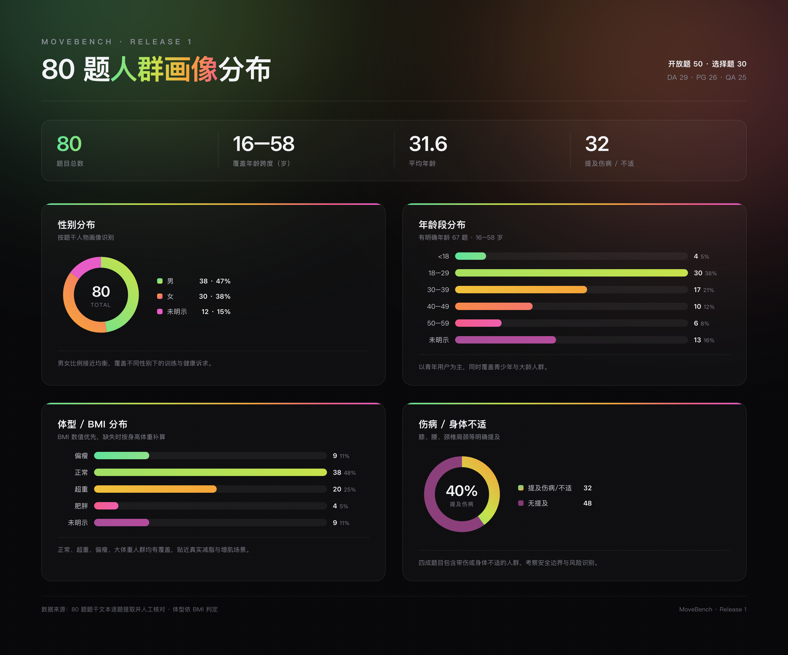

# MoveBench

中文运动健康教练大模型评测集 · **MoveBench Team x 首都体育学院**

[论文](https://arxiv.org/abs/2610.26185) · [在线题库与榜单](https://satosakula.github.io/MoveBench/) · [参评指南](docs/SUBMISSION.md) · [数据格式](docs/SCHEMA.md) · [English](docs/README_EN.md) 

公开提供 **80 道中文题目**，覆盖个性化课程方案 PG、运动数据解读 DA、专业知识问答 QA 三个场景，含 **50 道开放题（OQ）** 与 **30 道选择题（MCQ）**。

## 当前公开范围

| 范围 | 数量 |
|---|---:|
| OQ · 开放题（含 rubric 评分细则、参考答案） | 50 |
| MCQ · 选择题（单选 11 / 多选 19，含标准答案） | 30 |
| 合计 | **80** |

按领域分布：DA 29 / PG 26 / QA 25。开放题共 464 条 rubric 评分细则。

- `data/questions.json`：仅题目、ID、领域、题型（OQ 为空选项，MCQ 含选项）；不含参考答案和评分细则，供学生模型作答。
- `data/benchmark.json` / `data/test.jsonl`：完整记录。OQ 含 rubric 与参考答案，MCQ 含选项与标准答案；供评分、研究与自行复算。
- `data/submission_template.json`：全部 80 题的答案提交模板。
- `data/manifest.json`：版本、数量、校验值和数据集标识。
- `tools/`：学生模型作答与答案格式校验工具。

## 题目人群分布

80 道题均基于真实用户画像构建，覆盖不同性别、年龄、体型与身体状况。



| 维度 | 分布 |
|---|---|
| 性别 | 男 38 · 女 30 · 未明示 12 |
| 年龄 | 16–58 岁（均值 31.6）；18–29 最多（30 题），其次 30–39（17）、40–49（10）、50–59（6）、<18（4） |
| 体型 / BMI | 正常 38 · 超重 20 · 偏瘦 9 · 肥胖/大体重 4 · 未明示 9 |
| 伤病 / 不适 | 提及 32 题（膝、腰、颈椎肩颈等）· 无提及 48 题 |

覆盖的人群特征还包括：青少年（<18）与大龄用户（50+）、大体重与减脂人群、增肌人群、久坐上班族、以及带伤/康复期用户。这些画像分布使评测更贴近真实运动健康教练场景的多样性。

## 下载与作答

```bash
git clone https://github.com/Keep-Tech/MoveBench.git
cd MoveBench
python3 tools/validate.py
export STUDENT_API_KEY='在本机设置，不要提交到 GitHub'
python3 tools/run_student.py --model organization/exact-model-version \
  --base-url https://api.example.com/v1 --output predictions.json
python3 tools/validate.py --submission predictions.json
```

Python 3.10+，公开工具仅依赖标准库。`run_student.py` 对 OQ 发送问题全文、对 MCQ 附带选项并要求输出选项字母。也可使用本地权重或其他 API 自行生成相同格式的答案；题目输入与原 Release 1 保持一致。

## 提交与上榜

1. 完成全部 80 题，填写精确模型版本、生成设置，并披露是否曾接触本题库、历史参考答案或评分材料。
2. 通过 PR 将答案提交到 `submissions/<model>-<date>.json`。不要提交 API Key。
3. 维护者核对完整性，在私有维护端评分并审核，再发布汇总成绩到榜单。完整评分证据私有归档，不公开逐项标准。

尚不支持提交后即时自动评分。需要 API 代跑时先通过 Issue 联系维护者协调；不要公开粘贴凭据。模型身份由参评者声明。

## 适用范围与数据污染

本版本公开 rubric 评分细则和参考答案，并公开 MCQ 的标准答案。这意味着：外界可以检查评分标准、自行调用 Judge 复算 OQ、对 MCQ 自动判分，但**公开的评分标准与答案也可能被用于针对性优化或背题，造成数据污染**。因此：

- 公开版成绩仅供参考，不构成从未曝光的隐藏测试。
- 模型身份、生成设置及是否接触过本数据集由提交者声明，维护者可能要求补充生成记录。
- 成绩不构成医疗安全或真实训练效果认证。

